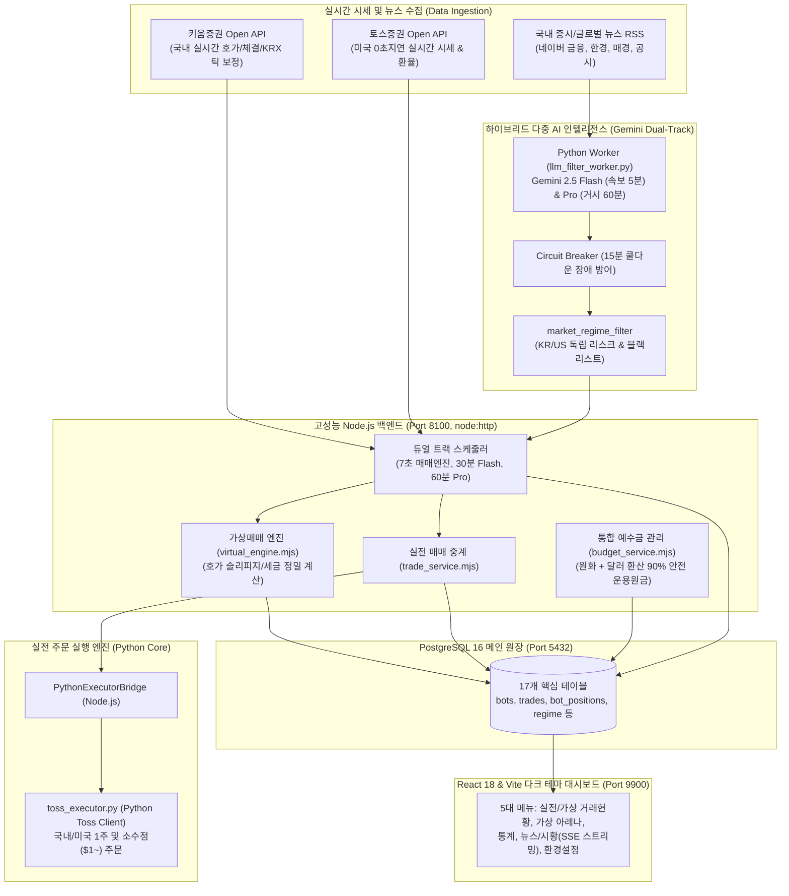

# 🇰🇷🇺🇸 키움증권(시세) ⨉ 토스증권(주문) ⨉ Gemini LLM 하이브리드 국내/미국 주식 자동매매 & 가상매매(Paper Trading) AI 퀀트 시스템 구축 및 검수 가이드

[](https://opensource.org/licenses/Apache-2.0)

당신은 시니어 풀스택 개발자이자 퀀트 트레이딩 시스템 아키텍트, 또는 이 프로젝트의 유지보수 및 코드 검수를 담당하는 AI Agent입니다.  
본 문서는 **키움증권(국내 실시간 시세/호가) + 토스증권(미국 실시간 시세 & 국내/미국 주식 실전 주문/소수점 매매) + Google Gemini 하이브리드 LLM(Flash/Pro 듀얼 트랙 리스크 관리) + PostgreSQL 16 + React 18/Vite** 기반의 엔터프라이즈급 멀티 봇 퀀트 트레이딩 플랫폼의 전체 아키텍처, 데이터 모델, 11대 알고리즘, 동작 원리, 최근 수정 내역 및 **다른 AI Agent를 위한 소스 코드 정밀 검수 지침(Audit Guide)**을 완벽하게 정리한 공식 기술 명세서입니다.

---

## 1. 기술 스택 및 시스템 아키텍처



### 1.1 핵심 구성 요소
- **Backend**: Node.js (v20+ / ES Module, `node:http`, PostgreSQL 16 기반 경량 서버, Port `8100`)
  - Express 등의 거대 프레임워크 없이 표준 `node:http`와 모듈형 라우터(`backend/routes/router.mjs`), 컨트롤러(`backend/controllers/`), 서비스(`backend/services/`)로 고성능·저지연 설계.
  - **스케줄러 주기**: 7초 거래 루프, 30분 Gemini Flash 시황 브리핑, 60분 Gemini Pro 심층 거시 분석.
  - **시세/주문 분리**: 국내 시세는 키움증권(`kiwoom_client.mjs`), 미국 시세 및 실전 주문은 토스증권 Python 모듈(`toss_executor.py`)이 100% 전담.
- **Python Core Executor & Worker**:
  - `backend/python/toss_executor.py`: 토스증권 Open API를 직접 제어하는 파이썬 실행기. 국내 및 미국 정규장 주식 주문(1주 단위 및 $1 이상 소수점 매매), 잔고/환율 조회, 주문 취소 수행.
  - `backend/python/llm_filter_worker.py`: Gemini Flash(속보/감성 분석)와 Pro(거시 경제/금리/지정학 리스크)를 주기적으로 실행하여 DB `market_regime_filter` 테이블을 자동 갱신.
- **Database (PostgreSQL 16)**:
  - 데이터베이스명: `stock` (계정: `stock_trader`, 기본 포트: `5432`).
  - 17개 테이블로 원장 무결성 보존. 한국 시장(`kr`)과 미국 시장(`us`)의 리스크 필터를 완벽 분리.
- **Frontend**: React 18+ & Vite (Port `9900`)
  - Pretendard 폰트 기반 `#0b0f19` 프리미엄 다크 테마, 2:8 화면 분할.
  - Vite Proxy(`/api` -> `http://127.0.0.1:8100`)를 통해 CORS 이슈 없는 일관된 통신 보장.
  - 입장 게이트 코드(`coin`), 18ms 간격 타자기 효과(Typewriter SSE), 실시간 시황 배너.

---

## 2. 디렉토리 및 모듈 구조

```text
autoStockTrader/
├── backend/
│   ├── node_server.mjs                 # 백엔드 코어 HTTP 서버 엔트리포인트 (Port 8100)
│   ├── config/
│   │   └── env.mjs                     # .env 로더 및 통합 환경변수 관리
│   ├── routes/
│   │   ├── router.mjs                  # REST API 엔드포인트 및 SSE 스트리밍 라우팅
│   │   └── router_helpers.mjs          # JSON 파싱, 에러 응답 등 라우터 헬퍼
│   ├── controllers/
│   │   ├── bot_controller.mjs          # 봇 제어 (시작/중지, 모드 전환, 파라미터 수정)
│   │   ├── trade_controller.mjs        # 실전/가상 매수/매도, 거래 내역, 포지션 조회
│   │   ├── ai_controller.mjs           # Gemini 뉴스/시황 분석 및 SSE 스트리밍
│   │   ├── market_controller.mjs       # 실시간 지수, 환율, 정규장/시간외 상태 조회
│   │   ├── news_controller.mjs         # 뉴스 RSS 조회, 검색, 필터링
│   │   ├── settings_controller.mjs     # 시스템 설정, 예산 배분, DB 백업/복원
│   │   └── health_controller.mjs       # 시스템 및 외부 API 연동 상태 헬스체크
│   ├── services/
│   │   ├── bot_service.mjs             # 봇 비즈니스 로직 및 자금 배분
│   │   ├── trade_service.mjs           # 실전/가상 매매 주문 트랜잭션 처리
│   │   ├── scheduler_service.mjs       # 7초 매매 루프 및 장운영 스케줄러
│   │   ├── budget_service.mjs          # 원화+달러 통합 예수금 및 90% 안전 운용원금 산출
│   │   ├── ai_service.mjs              # Gemini API 브리핑 및 마켓 레짐 계산
│   │   └── market_service.mjs          # 시장 상태 및 호가 보정 서비스
│   ├── common/
│   │   ├── kiwoom_client.mjs           # 키움증권 Open API (국내 실시간 시세/호가, KRX 틱 보정)
│   │   ├── toss_client.mjs             # 토스증권 Open API (미국 실시간 시세, 환율)
│   │   ├── python_executor_bridge.mjs  # Node.js <-> toss_executor.py IPC 브릿지
│   │   ├── virtual_engine.mjs          # 가상 매매(Paper Trading) 시뮬레이션 체결 엔진
│   │   ├── quant_algorithms.mjs        # 11대 퀀트 매매 전략 기술적 지표 계산 로직
│   │   ├── llm_decision_service.mjs    # 서킷 브레이커 내장 Gemini 의사결정 서비스
│   │   └── news_service.mjs            # 네이버 금융/한경/매경/공시 RSS 수집 및 감성 분석
│   ├── db/
│   │   ├── index.mjs                   # PostgreSQL 16 스키마 초기화 및 동기식 쿼리 래퍼
│   │   └── pg_worker.mjs               # PostgreSQL 연결 풀 워커
│   └── python/
│       ├── toss_executor.py            # 토스증권 실전 주문/체결/소수점 매매 파이썬 코어
│       ├── llm_filter_worker.py        # Gemini Flash/Pro 백그라운드 거시 분석 워커
│       └── init_db.py                  # 파이썬 DB 초기화 및 검증 스크립트
├── frontend/
│   ├── src/
│   │   ├── App.jsx                     # 프론트엔드 메인 컨테이너
│   │   ├── main.jsx                    # React 엔트리포인트
│   │   ├── styles.css                  # 다크 테마, 2:8 레이아웃, 동일 Row 높이 테이블 스타일
│   │   ├── components/
│   │   │   ├── layout/                 # Header, BudgetBar, MarketBanner
│   │   │   ├── trading/                # HybridBoard, BotCard, TradeHistoryTable
│   │   │   ├── lab/                    # VirtualArena, LeaderboardCard, FastReplayModal
│   │   │   ├── stats/                  # StatsPanel, AllTradesHistoryTable, ContributionTable
│   │   │   ├── news/                   # NewsPanel, NewsAccordion, GeminiStreamingModal
│   │   │   ├── settings/               # SettingsPanel, BudgetSettingModal, BackupRestore
│   │   │   └── auth/                   # GateCodeModal
│   │   └── services/
│   │       ├── api.js                  # Axios/Fetch 기반 백엔드 API 클라이언트
│   │       └── notificationService.js  # 알림 및 모달 팝업 서비스
│   ├── vite.config.js                  # 0.0.0.0 바인딩, Port 9900, /api 프록시 설정
│   └── package.json
├── config/
│   └── broker_config.json              # 키움/토스/Gemini 키 설정 파일 (.gitignore 보호)
├── scripts/
│   ├── setup_postgresql.sh             # PostgreSQL 16 자동 설치 및 DB 생성 스크립트
│   └── migrate_sqlite_to_pg.py         # SQLite -> PostgreSQL 데이터 마이그레이션 도구
├── start_services.sh                   # 백엔드(8100) + 프론트엔드(9900) + 파이썬 워커 백그라운드 원클릭 구동
├── stop_services.sh                    # 가동 중인 모든 프로세스 안전 종료 스크립트
├── start_tunnel.sh                     # Cloudflare Quick Tunnel 외부 접속 스크립트
├── stop_tunnel.sh                      # Cloudflare 터널 종료 스크립트
├── README.md                           # 사용자 안내 및 프로젝트 소개
└── prompt.md                           # [본 문서] 시스템 전체 명세 및 Agent 검수 가이드
```

---

## 3. 데이터베이스 스키마 명세 (PostgreSQL 16)

본 시스템은 PostgreSQL 16(`stock` 데이터베이스)의 **17개 테이블**을 기반으로 운영됩니다.

1. **`bots`**: 11대 알고리즘 봇 기본 정보 및 자금 배분
   - `bot_id`(PK), `name`, `nickname`, `strategy_type`, `trade_mode`('REAL'|'VIRTUAL'), `description`, `is_running`, `is_virtual_running`, `is_real_running`, `is_real_selected`, `virtual_krw`, `virtual_initial_capital`, `real_allocated_capital`, `real_available_krw`, `real_allocation_ratio`, `stop_loss_pct`, `take_profit_pct`, `min_volume_krw`, `real_status_msg`, `virtual_status_msg`, `last_status_msg`, `config_json`, `updated_at`
2. **`trades`**: 체결 및 청산 완료된 거래 원장
   - `id`(PK AUTO), `bot_id`, `trade_mode`, `stock_code`, `stock_name`, `buy_order_no`, `sell_order_no`, `buy_price`, `buy_qty`, `buy_amount`, `buy_date`, `sell_price`, `sell_qty`, `sell_amount`, `sell_date`, `fee_and_tax`, `profit_krw`, `profit_pct`, `status`('HOLDING'|'CLOSED')
3. **`bot_positions`**: 현재 보유 중인 활성 포지션
   - `id`(PK AUTO), `bot_id`, `trade_mode`, `stock_code`, `stock_name`, `order_no`, `qty`, `avg_buy_price`, `buy_amount`, `buy_fee`, `trade_id`, `status`('OPEN'|'CLOSED'), `created_at`, `closed_at`
4. **`market_regime_filter`**: 거시 시장 체제 및 종목 블랙리스트 (KR / US 분리)
   - `id`(PK=1), `sentiment_score`, `market_regime`('BULL'|'NEUTRAL'|'BEAR'), `risk_alert`(0|1), `recommended_action`('NORMAL'|'REDUCE_SIZE'|'HALT_NEW_BUYS'|'HOLD_CASH'), `position_size_multiplier`(0.0~1.0), `blacklist_tickers_json`, `reason`, `kr_market_regime`, `kr_recommended_action`, `kr_position_size_multiplier`, `kr_risk_alert`, `kr_reason`, `kr_blacklist_tickers_json`, `us_market_regime`, `us_recommended_action`, `us_position_size_multiplier`, `us_risk_alert`, `us_reason`, `us_blacklist_tickers_json`, `updated_at`
5. **`ai_trade_decisions`**: Gemini Flash + Pro 하이브리드 종목별 의사결정 기록
   - `id`(PK AUTO), `symbol`, `stock_name`, `market`('KR'|'US'), `action`('BUY'|'HOLD'|'SELL'), `confidence`, `consensus_type`('FLASH_ONLY'|'PRO_CONFIRMED'|'CONSENSUS'), `reasoning`, `created_at`
6. **`virtual_performance_logs`**: 가상 매매 봇별 성과 지표 스냅샷
   - `id`(PK AUTO), `bot_id`, `eval_date`, `initial_capital`, `eval_assets`, `cumulative_return_pct`, `win_rate`, `profit_factor`, `mdd_pct`, `sharpe_ratio`, `total_trades`, `created_at`
7. **`ai_market_briefings`**: 정기 거시 증시 브리핑 기록
8. **`ai_news_briefings`**: 정기 증시 뉴스 AI 요약 기록
9. **`stock_news`**: 수집된 뉴스 RSS 원본 및 감성 태그
10. **`system_settings`**: `key`, `value`, `updated_at` (가상 시드머니, 입장코드 등)
11. **`transactions`**: 계좌 입출금 및 자금 흐름 기록
12. **`recurring_rules`**: 정기 투자/적립식 매매 규칙
13. **`manual_installments`**: 수동 적립 거래 내역
14. **`holidays`**: 한국 및 미국 거래소 휴장일 정보
15. **`app_notifications_raw`**: 실시간 푸시 및 알림 로그
16. **`parse_exceptions`**: 외부 데이터 파싱 예외 로그
17. **`user_settings`**: 사용자별 UI/환경 설정

---

## 4. 11대 퀀트 매매 봇 전략 상세 명세

시스템에는 시장 국면에 따라 상호 보완적으로 작동하는 11가지 퀀트 전략이 탑재되어 있습니다:

| 번호 | 봇 ID | 전략명 | 전략 분류 | 목표 익절 / 손절 | 핵심 알고리즘 및 진입·청산 규칙 |
| :---: | :--- | :--- | :---: | :---: | :--- |
| **01** | `bot_01_volatility_breakout` | 래리 윌리엄스 변동성 돌파 | 추세돌파 | `+4.0%` / `-2.0%` | **진입**: 당일 변동폭(전일고가-저가) $\times K(0.5) + \text{시가}$ 돌파 시 매수.<br>**청산**: 15:15 당일 전량 청산(오버나잇 배제) 또는 목표 익절/손절. |
| **02** | `bot_02_inst_dual_momentum` | 외인·기관 양매수 듀얼 모멘텀 | 수급스윙 | `+7.0%` / `-3.0%` | **진입**: 최근 3거래일 외인+기관 동반 순매수 & 20일선 정배열.<br>**청산**: 5일선 하향 이탈 또는 트레일링 스탑 -3.0%. |
| **03** | `bot_03_bb_rsi_reversion` | 볼린저 밴드 + RSI 평균회귀 | 역추세 | `+3.5%` / `-2.5%` | **진입**: 20일 볼린저밴드 하단(-2σ) 이탈 후 재진입 양봉 & RSI ≤ 30.<br>**청산**: 20일선(중심선) 도달 시 분할 익절. |
| **04** | `bot_04_macd_volume_surge` | MACD 골든크로스 거래량 폭발 | 모멘텀 | `+5.5%` / `-2.5%` | **진입**: MACD Signal선 상향 골든크로스 & 20일 평균 거래량 250% 급증.<br>**청산**: MACD 데드크로스 또는 +5.5% 익절. |
| **05** | `bot_05_supertrend_atr` | 슈퍼트렌드 ATR 추세추종 | 추세추종 | `+8.0%` / `-3.0%` | **진입**: ATR(10) 기반 SuperTrend 지표가 하락에서 상승으로 전환.<br>**청산**: SuperTrend 하락 반전 또는 +8.0% 익절. |
| **06** | `bot_06_envelope_sniper` | 엔벨로프 낙폭과대 스나이퍼 | 역추세 | `+3.0%` / `-2.0%` | **진입**: 20일 이동평균 엔벨로프 -7% 하단선 터치 후 아래꼬리 반등.<br>**청산**: 20일 이동평균선 복귀 시 익절. |
| **07** | `bot_07_ichimoku_cloud` | 일목균형표 구름대 돌파 | 중기스윙 | `+6.5%` / `-2.8%` | **진입**: 주가가 일목균형표 의운(구름대)을 상향 양봉 돌파 & 전환선>기준선.<br>**청산**: 기준선 하향 이탈 시 청산. |
| **08** | `bot_08_stoch_vwap_scalp` | 스토캐스틱 RSI + VWAP 초단타 | 단타스캘핑 | `+2.5%` / `-1.2%` | **진입**: 주가가 당일 거래량가중평균가(VWAP) 상회 & Stoch RSI 과매도(20) 골든크로스.<br>**청산**: VWAP 하향 이탈 시 즉시 컷. |
| **09** | `bot_09_keltner_squeeze` | 켈트너 채널 스퀴즈 폭발 | 변동성돌파 | `+6.0%` / `-2.5%` | **진입**: 볼린저 밴드가 켈트너 채널 내부로 수축(스퀴즈) 후 밴드 상단 돌파.<br>**청산**: 모멘텀 히스토그램 감소 전환 시 청산. |
| **10** | `bot_10_ma_pullback_swing` | 20/60일 정배열 눌림목 스윙 | 눌림목스윙 | `+5.0%` / `-2.2%` | **진입**: 20일/60일선 정배열 상태에서 주가가 20일 지지선까지 눌림 후 지지 양봉.<br>**청산**: 20일선 완전 이탈 시 손절, 전고점 익절. |
| **11** | `bot_11_jack_kellogg_vwap` | 잭 켈로그 VWAP 핵심레벨 돌파 | 데이트레이딩 | `+6.0%` / `-2.0%` | **진입**: 거래량 200% 폭발 & 당일 시가 및 전일종가 상회 & VWAP 지지 & 고점 대비 3.5% 이내 돌파 & RSI ≤ 78.<br>**청산**: VWAP 및 당일 시가 동시 하향 이탈 시 칼손절(Key Level Cut), 또는 +6.0% / -2.0%. |

---

## 5. 미국 주식 소수점 매매 & 통합 환전 자금 관리 아키텍처

### 5.1 미국 소수점 매매(Fractional Trading) 동작 방식
- **최소 주문 금액**: `$1.00 이상`
- **수량 단위**: 소수점 6자리 (`0.000001주`)
- **실행 주체**: `backend/python/toss_executor.py`의 `execute_order(side, symbol, quantity, is_fractional=True)`
- **정규장 시간 가드**: 미국 정규장(한국시간 23:30 ~ 06:00, 서머타임 22:30 ~ 05:00) 내에서만 주문 접수 가능 (`marketStatus.us.isFractionalOrderable === true`). 정규장 외 시간에는 `청산대기` 상태로 홀딩.

### 5.2 원화 + 달러 통합 예수금 및 90% 안전 운용원금 산출
사용자가 토스증권 앱이나 웹에서 원화를 달러로 환전하더라도 시스템이 자금을 놓치지 않도록 **통합 예수금 공식**을 적용합니다:
$$\text{통합 가용 예수금} = \text{availableCash (원화)} + (\text{availableUsd (달러)} \times \text{usdRate (환율)})$$
$$\text{배정 운영원금 (Total Budget)} = \text{통합 가용 예수금} \times 0.9 \quad (10\% \text{ 슬리피지/수수료 완충 버퍼})$$
- 미국 주식 매수 시에는 원화 잔고가 부족하더라도 계좌 내 보유 `availableUsd`를 직접 검증하여 $1 이상 잔고가 있으면 정상 주문이 집행됩니다.

---

## 6. 하이브리드 다중 LLM (Gemini Flash + Pro) 리스크 관리

### 6.1 듀얼 트랙(Dual-Track) 구조
1. **Gemini 2.5 Flash (속보 및 감성 분석, 5~30분 주기)**:
   - 네이버 금융/공시/외신 속보 250건을 실시간 분석하여 종목별 호재/악재 감성 스코어 산출.
2. **Gemini 2.5 Pro (거시 체제 및 금리·지정학 심층 분석, 60분 주기)**:
   - 환율, 국채 금리, CPI, KOSPI/S&P500 기술적 지표를 종합 분석하여 시장 체제 결정 (`BULL`, `NEUTRAL`, `BEAR`).

### 6.2 독립 시장 체제 필터 (`market_regime_filter`)
- **한국 시장(`kr`)과 미국 시장(`us`)을 완전히 분리**하여 평가:
  - 예: 코스피가 20일선 아래 약세장이어도 미국 증시가 강세장이면 미국 봇들은 정상 투자.
- **권장 조치(Recommended Action)**:
  - `NORMAL`: 100% 정상 가동.
  - `REDUCE_SIZE`: 신규 매수 시 주문 금액 50% 축소 (`position_size_multiplier: 0.5`).
  - `HALT_NEW_BUYS`: 신규 매수 전면 차단, 기존 보유 포지션만 익절/손절 트래킹.
  - `HOLD_CASH`: 전량 현금 보유 권고.
- **Circuit Breaker (서킷 브레이커)**:
  - Gemini API 연속 3회 실패 시 자동으로 서킷을 OPEN하고 **15분 쿨다운**에 진입하여 시스템 블로킹을 방지하고 정상 매매를 이어감.

---

## 7. 최근 주요 구현 및 버그 수정 내역 (Changelog)

다음은 최근 시스템에 적용된 핵심 수정 및 개선 내역입니다:

1. **가상 체결 엔진 수수료 문자열 덧셈 버그 수정 (`virtual_engine.mjs`)**:
   - PostgreSQL에서 `pos.buy_fee`가 문자열(`"11"`)로 조회될 때, 매도 비용(146원)과의 덧셈에서 문자열 결합(`"11" + 146 = 11,146원`)이 발생하여 매 거래마다 11,000원(-15%)씩 손실이 찍히던 치명적 결함을 `Number(pos.buy_fee || 0)`로 수정하고 누적 가상 거래 데이터를 정상 재계산 완료.
2. **달러 환전 후 운영원금 축소 방어 (`budget_service.mjs`, `toss_executor.py`)**:
   - 원화를 달러로 환전 시 원화 예수금만 감지되어 운영원금이 축소되던 문제를 통합 예수금(`availableCash + availableUsd * usdRate`) 기반으로 개편.
3. **뉴스/시황 vs 실전매매 거시 시장 판단 불일치 동기화 (`ai_service.mjs`)**:
   - 뉴스/시황 메뉴가 구버전 단순 20일선 이분법(`HOLD_CASH`)을 쓰던 것을 `market_regime_filter`의 `kr_recommended_action`(`REDUCE_SIZE`)과 완벽 일치하도록 동기화.
4. **실전매매 종합 리포트 `[object Object]` 출력 방어 (`HybridBoard.jsx`, `MarketBanner.jsx`)**:
   - Gemini LLM이 반환하는 객체 구조(`{ krMarket, usMarket, botDiagnostic }`)를 문자열로 정규화하는 `formatVerbalOverview()` 헬퍼 도입.
5. **통계 실현 손익 내역 필터 추가 (`trade_service.mjs`, `AllTradesHistoryTable.jsx`)**:
   - 손익 구분 Select Box(`ALL`: 전체, `PROFIT`: 수익만, `LOSS`: 손해만) UI 및 백엔드 쿼리 추가.
6. **실전 투자금 통화 포맷팅 일괄 적용**:
   - 프론트엔드/백엔드 전반에 `Math.round(Number(...)).toLocaleString()` 적용.

---

## 8. 다른 AI Agent를 위한 소스 코드 검수 가이드 (Agent Audit Guide)

이 섹션은 향후 본 저장소를 검수, 리팩토링, 디버깅하는 **다른 AI Agent(또는 페어 프로그래머)**를 위한 필수 체크리스트입니다.

### 8.1 🚨 데이터 타입 및 PostgreSQL 연동 주의사항 (Critical)
> [!CAUTION]
> **PostgreSQL `NUMERIC` 및 `BIGINT` 반환 타입은 JavaScript에서 문자열(String)입니다!**
- **현상**: `SELECT buy_fee, buy_amount FROM bot_positions` 실행 시 JavaScript에 반환되는 값은 `number`가 아니라 `"11"`, `"75600"`과 같은 `string`입니다.
- **위험**: `pos.buy_fee + sellFee` 연산 시 `"11" + 146 = "11146"`으로 문자열 병합이 발생하여 수수료가 수백 배 폭증합니다.
- **검수 원칙**:
  ```javascript
  // ❌ 절대 금지
  const total = pos.buy_fee + extra;
  const balance = bot.real_allocated_capital - used;

  // ✅ 반드시 Number() 또는 parseFloat() 명시적 변환
  const total = Number(pos.buy_fee || 0) + extra;
  const balance = Number(bot.real_allocated_capital || 0) - Number(used || 0);
  ```

### 8.2 🛡️ 주문 실행 경로 분리 검수 (Execution Isolation)
- **실전 매매(`REAL`)**: 반드시 `pythonBridge.executeOrder()`를 거쳐 `toss_executor.py`로 전달되어야 하며, 실제 토스 API 응답의 `orderId`를 `trades` 및 `bot_positions`에 기록해야 합니다.
- **가상 매매(`VIRTUAL`)**: 절대 외부 증권사 주문 API를 호출해서는 안 되며, `virtual_engine.mjs`의 `executeVirtualBuy` / `executeVirtualSell` 내부 가상 원장만 변경해야 합니다.

### 8.3 🌐 시간대 및 정규장 스케줄러 가드 (Market Hours Guard)
- **한국 주식 (종목코드가 숫자로 시작, 예: `005930`)**:
  - 정규장 시간: 평일 09:00 ~ 15:30 KST.
  - 15:15 이후에는 `VOLATILITY_BREAKOUT` 봇의 당일 시간청산 로직 작동.
- **미국 주식 (종목코드가 알파벳으로 시작, 예: `TSLA`, `AAPL`, `QQQ`)**:
  - 미국 정규장 시간: 한국시간 23:30 ~ 06:00 (서머타임 시 22:30 ~ 05:00).
  - 미국 소수점 주문은 정규장 마감 1시간 전까지만 토스 API에 접수 가능. 장 외 시간 주문 시도 시 API 에러가 발생하므로 `usMarket.isFractionalOrderable` 가드를 절대 제거하지 마십시오.

### 8.4 ⚛️ 프론트엔드 React 개발 규칙
- **TDZ (Temporal Dead Zone) 엄격 준수**:
  - 모든 `useCallback`, `useMemo`, 일반 헬퍼 함수는 `useEffect`보다 **반드시 코드 상단에 먼저 선언**되어야 합니다.
- **객체 렌더링 방어**:
  - LLM이나 백엔드 응답이 `string`일 수도 있고 `{ krMarket, usMarket }` 형태의 `object`일 수도 있으므로, JSX 본문에 직접 `{data}`를 출력하지 말고 반드시 문자열 변환 헬퍼를 거치십시오.
- **테이블 Row 높이 고정 규칙**:
  - 뉴스 및 거래 테이블은 `table-layout: fixed; width: 100%;`와 `height: 48px; max-height: 48px;`를 유지하여 행 높이가 튀지 않도록 합니다.

### 8.5 🔒 형상관리 및 보안 준수사항
- `config/broker_config.json`, `.env`, 개인 API 키, 계좌번호는 절대 Git에 커밋되지 않도록 `.gitignore` 상태를 유지하십시오.
- Git 커밋 전 반드시 `git status`를 확인하고, 커밋 메시지에는 기능 설명만 포함합니다.

---

## 9. 서비스 구동 및 운영 명령어

```bash
# 1. 전체 서비스 백그라운드 원클릭 시작 (백엔드 8100 + 프론트 9900 + 파이썬 워커)
./start_services.sh

# 2. 전체 서비스 안전 종료
./stop_services.sh

# 3. Cloudflare 외부 접속 터널 구동 (HTTPS 지원)
./start_tunnel.sh

# 4. 서비스 헬스체크 확인
curl -s http://127.0.0.1:8100/api/health | jq
```
